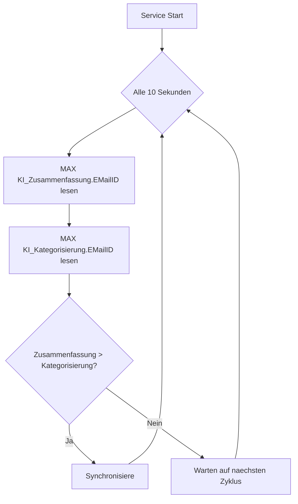

# Wecollect Kategorisierung Service

Windows-Service zum Nachziehen fehlender KI-Kategorisierungen.

## Zweck

Der Service sorgt dafuer, dass zwischen `KI_Zusammenfassung` und `KI_Kategorisierung` kein Rueckstand entsteht.
Er greift bewusst NICHT auf `EMail_Postfach` zu - Betreff/Body wurden dort bereits von
`Wecollect-EMailWatcher-Service` aufbereitet und als `KIInput` in `KI_Zusammenfassung` gespeichert.
Alle SQL-Operationen laufen ausschliesslich ueber die DLL-Klassen `wecollect.KI.KI_Kategorisierung`
und `wecollect.KI.KI_KategorisierungPersistenz` (wecollect-InkassoDLL).

## KI-Worker in Kurzform

1. Startet als Windows-Service (`WecollectKategorisierung`).
2. Verbindet sich ueber `wecollect.Datenbank.Db_Connect` mit der Datenquelle (innerhalb der DLL-Klassen).
3. Prueft alle 10 Sekunden auf neue, noch nicht kategorisierte EMailIDs.
4. Vergleicht den Stand von `KI_Zusammenfassung` (Quelle) und `KI_Kategorisierung` (Ziel).
5. Wenn `KI_Kategorisierung` hinterherhaengt, startet er den Sync:
   `wecollect.KI.KI_KategorisierungPersistenz.Synchronisiere(letzteKategorisierungID, aktuelleMaxID)`.

## Ablaufdiagramm

## Relevante Dateien

- `Wecollect-Kategorisierung-Service/Program.cs`
- `Wecollect-Kategorisierung-Service/Worker.cs`
